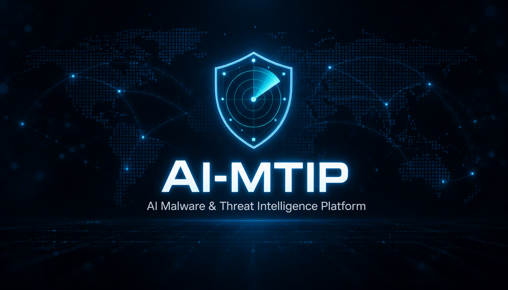
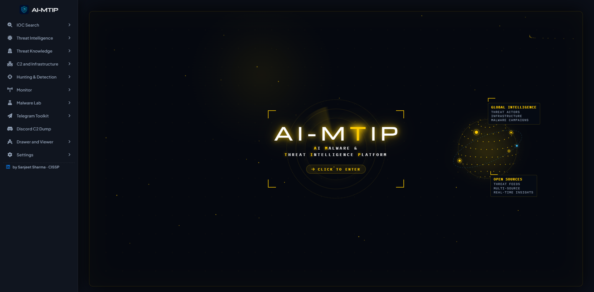
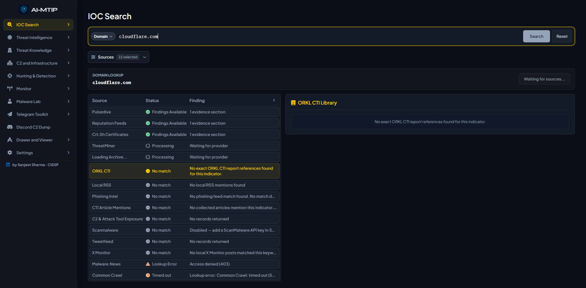
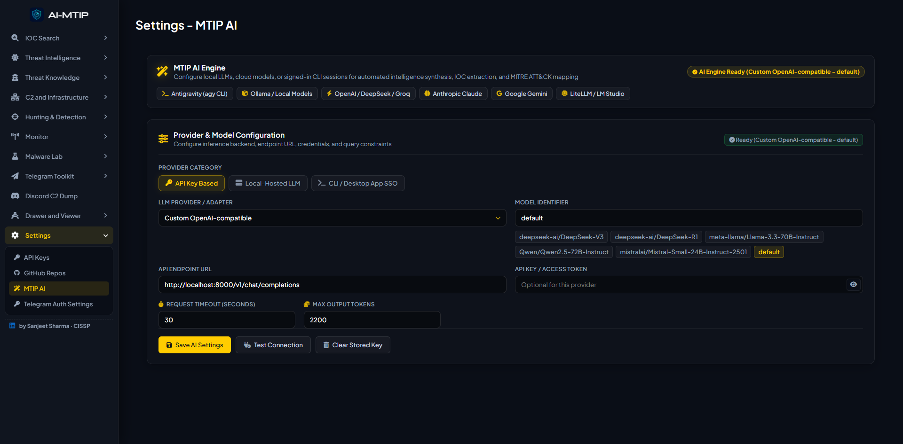
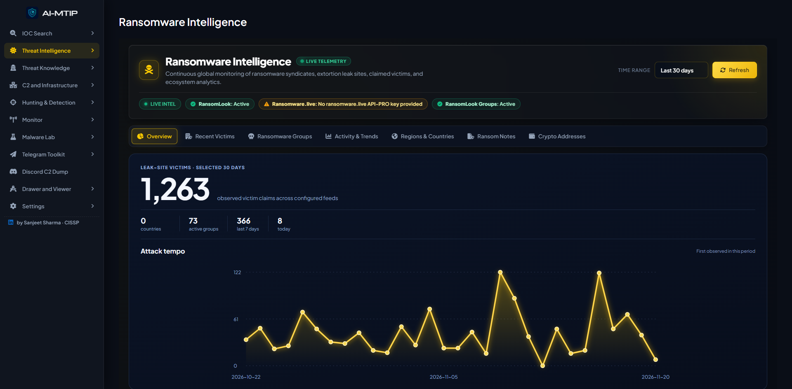
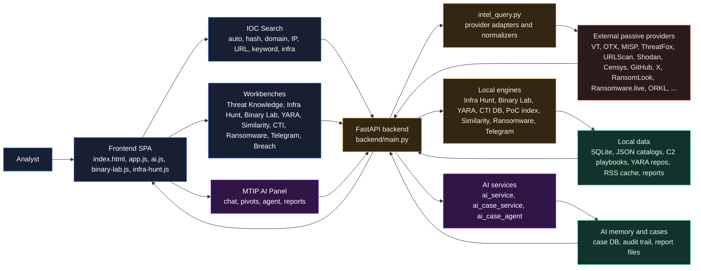

<p align="center">
  
</p>

<h1 align="center">AI-MTIP</h1>

<p align="center">
  <strong>AI Malware &amp; Threat Intelligence Platform</strong><br/>
  A local-first threat intelligence workbench for IOC enrichment, OSINT collection, ransomware &amp; breach monitoring, YARA operations, malware similarity, and AI-assisted investigations.
</p>

<p align="center">
  <a href="#license"></a>
  <a href="#quick-start"></a>
  <a href="#quick-start"></a>
  <a href="https://www.linkedin.com/in/sanjeet-sharma-cissp-17b68570/"></a>
</p>

---

Built and maintained by **Sanjeet Sharma · CISSP** — connect with me on [LinkedIn](https://www.linkedin.com/in/sanjeet-sharma-cissp-17b68570/).

## Why AI-MTIP

Most threat-intelligence tooling solves one slice of the problem well: enrichment, knowledge graphs, sharing, or monitoring. AI-MTIP consolidates the whole investigation loop — search, enrich, monitor, analyze, and report — into **one local workbench** with an evidence-aware AI assistant that reasons over the results you actually collected, not a black box.

- **One investigation surface** — IOC enrichment, threat-actor knowledge, daily intelligence, ransomware tracking, vulnerability and PoC feeds, breach monitoring, and social/Telegram collection in a single UI.
- **Built-in analyst workbenches** — YARA exploration and authoring, malware similarity, and IDA Pro / Ghidra-backed binary analysis are first-class workflows, not external handoffs.
- **Evidence-aware AI** — the assistant reads collected provider evidence and the current page context, recommends passive pivots, scores attribution, and keeps every underlying source result visible.
- **Local-first** — designed to run on an analyst workstation or a team server, with API keys stored locally and read-only collection guardrails by default.

## Highlights

- **IOC Search** — auto-detect or manually search hashes, domains, IPs, URLs, keywords, and infrastructure targets across free and API-backed sources; normalized result cards, per-source drawers, history, and exports.
- **MTIP AI** — evidence-aware chat, findings summaries, pivot recommendations, bounded autonomous agent mode, AEAD case workflow, attribution scoring, correlation analysis, YARA assistance, and report exports (MD / JSON / HTML / AI workspace bundles).
- **Infrastructure Hunting** — pivot from any seed (IP, domain, ASN, CIDR, cert SHA-256) into adversary infrastructure; extracts JA4/JARM, TLS certificates, favicon MMH3, and HTTP headers; matches 1,000+ curated C2 playbooks (Cobalt Strike, Sliver, Havoc, Metasploit, ...); correlates Shodan, Censys, FOFA, Netlas, URLScan, Silent Push, Driftnet, Validin, and Etugen; GreyNoise anti-noise scoring, interactive graphs, and scheduled recurring hunts.
- **AI Binary Analysis Lab** — PE / ELF / Mach-O and managed .NET reverse engineering with dual headless IDA Pro and Ghidra backends, GoReSym symbol recovery, automated function/variable renaming, offline AI workspace export, and multi-format reporting (HTML, Markdown, PDF).
- **VirusTotal Bulk Samples Downloader** — batch-download malware binaries by hash (up to 50) to a local folder or a password-protected AES-256 ZIP, integrated with VT live-hunt monitoring.
- **Threat Knowledge** — MISP Galaxy threat actors, malware/tools, ransomware groups, Microsoft Activity Groups, Tidal groups, surveillance vendors, Malpedia families, and Kaspersky TIP profiles.
- **MISP Intelligence** — query a configured MISP instance as a passive, read-only correlation source for events, tags, galaxies, sightings, warning lists, and related indicators.
- **Ransomware Monitor** — victims, groups, trends, countries, ransom notes, crypto addresses, and watchlists from RansomLook, Ransomware.live, and ThreatLabz notes.
- **YARA Ecosystem** — explore local rule repositories, scan samples, validate and author rules, run corpus/path/upload tests, and use AI to explain or fix rules.
- **Similarity Engine** — entity building from samples, static plus optional IDA/Hex-Rays feature extraction, sample comparison, and function/block/API inspection with tunable thresholds.
- **CTI Articles** — RSS/CTI feed ingestion, IOC extraction, category management, local corpus search, and AI article summaries.
- **Vulnerability Intelligence** — CVE/PoC tracking, CISA KEV context, trending public exploits, and OSV malicious-package intelligence.
- **Telegram Toolkit** — MTProto channel monitoring, stealer-log parsing, target exposure tracking, and bot-token investigations.
- **X Monitor** — collect and filter monitored X/Twitter accounts and infosec chatter for emerging IOC and vulnerability leads.
- **Breach Watcher** — aggregate breach and infostealer sources (DataBreach.watch, HaveIBeenPwned, DataBreaches.net, Leak-Lookup, and more).
- **Today's Intelligence** — a daily rollup of CTI articles, exploited vulnerabilities, PoCs, ransomware activity, and social signals with optional AI briefs.
- **MCP Server & Agent CLI** — expose AI-MTIP capabilities to external agents via the built-in MCP server (`backend/mtip_mcp_server.py`) or drive investigations from the command line (`backend/mtip_agent_cli.py`).

## Screenshots

| | |
|---|---|
|  |  |
|  |  |


Additional captures for every interface area live in [`docs/screenshots/`](docs/screenshots/).

## Real-World Value

### Who it is for

| Role | What AI-MTIP gives them |
|---|---|
| **SOC / Triage analysts** | One search box for any indicator — hash, IP, domain, URL, or keyword — with normalized verdicts from dozens of sources instead of a browser full of tabs. Search history and CSV/JSON exports drop straight into tickets. |
| **CTI analysts** | Daily intelligence rollup, curated threat-actor and malware knowledge (2,200+ actors), ransomware group tracking, CTI article corpus with IOC extraction, and AI-assisted reporting with every source citation preserved. |
| **Incident responders** | Rapid passive enrichment during an incident, infrastructure pivots from a single known-bad host, C2 playbook fingerprint matching (JA4/JARM/favicon), and breach/stealer-log exposure checks for affected users. |
| **Threat hunters** | Automated infrastructure pivoting across Shodan/Censys/FOFA/Netlas/URLScan and more, a 1,000+ entry C2 hunting catalog, Sigma and YARA ecosystems, and scheduled recurring hunts with noise scoring. |
| **Malware analysts** | IDA/Ghidra-driven static analysis lab, similarity comparison against tracked entities, sample acquisition via VirusTotal bulk download, and multi-format report generation (HTML / Markdown / PDF). |
| **Small security teams & consultants** | A self-hosted alternative to stitching together a dozen SaaS subscriptions — the majority of sources are free, keys are optional, and all data stays on your own hardware. |

### The value in practice

- **Speed** — what normally takes ten browser tabs, manual copy-pasting, and a notes file becomes one search with structured, exportable results.
- **Context, not just data** — actor dossiers, malware families, campaigns, and vulnerability context are one click away from any indicator, and the AI assistant can connect the dots across everything you collected in a case.
- **Privacy and control** — passive, read-only collection by design; API keys and case data never leave your machine. AI providers are optional and configurable (including fully local LLMs via Ollama/LM Studio).
- **Auditability** — every AI statement is grounded in collected evidence; the agent bridge ships permission policies, rate limits, redaction, and a tamper-evident audit trail (`agent_audit.jsonl`).

## Architecture



The backend is FastAPI (Python 3.10+) with SQLite for local state; the frontend is a dependency-free vanilla-JS SPA served directly by the backend. No Docker, database server, or Node runtime is required to run the platform.

## Quick Start

### Requirements

- Python 3.10 or newer
- A modern browser
- Optional: Telegram API credentials (Telegram Toolkit), IDA Pro / Ghidra for richer Binary Lab and similarity features, provider API keys for keyed sources

### Windows

```cmd
run.bat
```

On first launch the launcher asks you to choose a **Deployment Mode** (saved to `.env`):

- **[1] Workstation Mode** (default) — local PC with native file pickers.
- **[2] Team Server Mode** — multi-user server with web staging and auto-discovery.

The app starts at `http://127.0.0.1:9999`.

```cmd
set MTIP_PORT=8000
run.bat --server          :: Team Server mode
run.bat --workstation     :: Workstation mode
run.bat --reconfigure     :: Re-run the mode setup prompt
```

Useful variables: `MTIP_PORT`, `MTIP_MODE`, `MTIP_SKIP_DEPS=1`, `MTIP_FORCE_DEPS=1`, `MTIP_RELOAD=1`.

### Linux

```bash
chmod +x start_linux.sh
./start_linux.sh            # or: ./start_linux.sh --server
```

The script creates `backend/venv`, installs dependencies, and starts the backend.

### Manual development run

```bash
pip install -r requirements.txt
python -m uvicorn main:app --app-dir backend --host 127.0.0.1 --port 9999
```

## First-Run Setup

1. **Choose a deployment mode** — Workstation (single analyst PC) or Team Server (shared host). Changeable later under **Settings → Deployment Mode** or `run.bat --reconfigure`.
2. **Add provider keys (optional)** — under **Settings → API Keys**. Everything works without keys; keys unlock premium sources (VirusTotal, Shodan, Censys, GreyNoise, MISP, Kaspersky TIP, and more).
3. **Configure the AI engine** — under **Settings → MTIP AI**. Supported backends:
   - **Antigravity (agy CLI)** and **CLI / Desktop App SSO** providers
   - **Local-hosted models** — Ollama, LM Studio, LiteLLM (your data never leaves the machine)
   - **API-key providers** — OpenAI / DeepSeek / Groq, Anthropic Claude, Google Gemini
   - Set the endpoint, model, timeout, and token budget, then use **Test Connection** to validate.
4. **Optional integrations** — Telegram MTProto credentials (**Settings → Telegram Auth**), MISP instance details, and IDA Pro / Ghidra paths for the Binary Lab.

## Interface Guide

AI-MTIP's navigation is a slim rail on the left that expands on hover. Every major capability has its own page:

### IOC Intelligence
| Page | What it does / how to use it |
|---|---|
| **IOC Search** | The core workflow. Paste any hash, domain, IP, URL, keyword, or infrastructure value — the type is auto-detected (or pick it manually). Results stream in from ~15–26 configured sources with per-source status, findings, and expandable evidence drawers. Filter sources before searching, save result sets, and export. |
| **Search History** | Reopen, review, or re-run past lookups; cached results restore instantly. |

### Threat Intelligence
| Page | What it does / how to use it |
|---|---|
| **Today's Intelligence** | The daily operational picture: fresh CTI articles, exploited vulnerabilities, public PoCs, ransomware activity, and social signals in one rollup. Optionally generate an AI brief for standup meetings. |
| **Ransomware Monitor** | Live ransomware telemetry across seven tabs — Overview, Recent Victims, Groups, Activity & Trends, Regions & Countries, Ransom Notes, and Crypto Addresses. Use watchlists to flag sectors or regions you care about. |
| **CTI Articles** | A local corpus of ingested RSS/CTI feeds with automatic IOC extraction, category management, full-text search, and AI article summaries. |
| **Country & Industry Reports** | Country- and industry-focused intelligence reporting views. |
| **Vulnerability Intelligence** | CVE prioritization with public PoC tracking, CISA KEV context, trending exploit repositories, and references. |
| **Malicious Packages** | OSV-based malicious package intelligence for software supply-chain awareness. |

### Threat Knowledge
| Page | What it does / how to use it |
|---|---|
| **Threat Actor** | Searchable dossiers across MISP Galaxy, Microsoft, Tidal, and surveillance-vendor sources (2,200+ entities): aliases, nation-state attribution, targeted sectors, and TTPs. Pivot any actor name straight into IOC Search. |
| **Malware & Tools** | The same galaxy treatment for malware families and attack tooling. |

### C2 and Infrastructure
| Page | What it does / how to use it |
|---|---|
| **Infra Search** | Pivot from any infrastructure seed (IP, domain, ASN, CIDR, certificate) through Shodan, Censys, FOFA, Netlas, URLScan, and more. |
| **Automated Infrastructure Pivoting** | Seed-to-campaign infrastructure expansion with JA4/JARM/TLS/favicon-MMH3 fingerprinting and interactive graphs. |
| **Open Directory Hunting** | Discover exposed directories and open shares relevant to your investigations. |
| **C2 Hunting Catalog** | 1,000+ curated C2 fingerprints (Cobalt Strike, Sliver, Havoc, Metasploit, ...) matched against your hunt results. |
| **C2 & Attack Tool Exposure** | Track exposed C2 and attack-tool panels in the wild. |
| **Data Feeds** | Manage 13 built-in reputation feeds (C2 trackers, phishing domains, botnet C2, ET rules), sync them on schedule, and export cached indicators (175k+ rows) as CSV for firewalls, SIEMs, and blocklists. |
| **Infrastructure Hunt History** | Review and compare past hunts; re-open graphs and results. |

### Hunting & Detection
| Page | What it does / how to use it |
|---|---|
| **Threat Hunting Library** | A curated library of hunting methodologies and queries to adapt to your environment. |
| **SIGMA suite** | Rules Explorer, Detection Statistics, Emerging Threats & CVEs, MITRE ATT&CK Matrix, and a Query Converter — browse, assess coverage, and translate detection logic. |
| **YARA** | Rule Explorer (browse synced public repos), Sample Scanner (test rules against local samples), and Rule Workbench (author, validate, AI-explain, and fix rules). |

### Monitor
| Page | What it does / how to use it |
|---|---|
| **X Monitor** | Collects and filters monitored X/Twitter accounts and infosec chatter for emerging IOC, campaign, and vulnerability leads. |
| **Breach Watcher** | Aggregated breach and infostealer coverage (DataBreach.watch, HaveIBeenPwned, DataBreaches.net, Leak-Lookup, and more). |
| **Credential Stealer** | Focused view over stealer-log intelligence for credential exposure. |
| **Telegram Channel Monitor** | Watch authenticated Telegram channels for IOCs, archives, victim mentions, and target references. |

### Malware Lab
| Page | What it does / how to use it |
|---|---|
| **AI Binary Analysis Lab** | Upload or reference a sample and run static analysis with headless IDA Pro or Ghidra, .NET decompilation via ILSpy, GoReSym symbol recovery, AI-assisted renaming, 6-category attribution assessment, and Markdown/HTML/PDF report generation. Samples are never executed. |
| **Malware Repository** | Local repository of tracked families and samples feeding the similarity engine. |
| **VT Samples Downloader** | Batch-download up to 50 samples by hash list, optionally into a password-protected AES-256 ZIP. |
| **Similarity** | Dashboard, Entities, Create, Compare, and Settings — build entities from samples, extract static (and optionally IDA/Hex-Rays) features, compare new samples against known families, and inspect function/block/API overlap. |

### Telegram Toolkit
| Page | What it does / how to use it |
|---|---|
| **Bot Info** | Validate bot tokens and inspect bot identity. |
| **Channel Monitor** | MTProto-based channel collection with IOC/credential/archive/victim extraction. |
| **Investigations** | Target exposure tracking and stealer-log parsing investigations. |
| **Telegram Auth Settings** | Manage API ID/hash and session strings. |

### Also included
- **Discord C2 Dump** — collected Discord-based C2 extraction feeds.
- **Drawer and Viewer** — diagram, flowchart, mindmap, map-chart, Mermaid, and Markdown canvases for mapping campaigns and infrastructure during analysis.
- **Settings** — API Keys, GitHub Repos, MTIP AI engine, Deployment Mode, Users & Team (server mode), Telegram Auth.

## Guided Workflows

### 1. Investigate an indicator end-to-end
1. Open **IOC Search**, paste the indicator, press **Search**.
2. Watch sources resolve; expand a source's drawer for raw findings and evidence sections.
3. Right-side context (ORKL reports, article mentions, related knowledge) fills in as results arrive.
4. Open the **MTIP AI** panel — ask for a findings summary, attribution hypotheses, or recommended passive pivots; every claim links back to collected evidence.
5. **Save Results** to history, or export for your ticket / report.

### 2. Hunt adversary infrastructure
1. Start from a seed (known-bad IP, domain, cert SHA-256) in **Infra Search** or **Automated Infrastructure Pivoting**.
2. Review extracted fingerprints (JA4, JARM, TLS, favicon MMH3, HTTP headers) and let the engine correlate across Shodan, Censys, FOFA, Netlas, URLScan, Silent Push, and others.
3. Check **C2 Hunting Catalog** matches — a playbook hit turns "similar server" into "Cobalt Strike team server".
4. Use GreyNoise scoring to suppress internet-wide noise, inspect the graph, then schedule the hunt as a recurring monitor in **Infrastructure Hunt History**.

### 3. Triage a malware sample
1. Acquire samples with the **VT Samples Downloader** (hash list → folder or encrypted ZIP).
2. Run the sample through the **AI Binary Analysis Lab** — pick IDA or Ghidra, let GoReSym and AI renaming recover meaning, and review the 6-category attribution assessment.
3. Compare against known entities in **Similarity** to link the sample to tracked families or actors.
4. Craft a detection rule in the **YARA Rule Workbench** (AI can draft and fix rules), validate against your corpus, and export the report (Markdown / HTML / PDF).

### 4. Track ransomware and exposure
1. Make **Ransomware Monitor** your morning check: new victims, group trends, regional activity, fresh ransom notes and crypto addresses.
2. Cross-check exposed credentials in **Breach Watcher** and **Credential Stealer**.
3. Pull fresh reputation indicators from **Data Feeds** and export CSVs for your blocklists.
4. Save notable items into an AI case and generate a summary for stakeholders.

### 5. Produce the daily briefing
1. Open **Today's Intelligence** for the automated rollup.
2. Generate the AI brief, prune what doesn't apply to your sector, and share it.
3. Deep-dive anything relevant via IOC Search, CTI Articles, or Vulnerability Intelligence.

## Automation & Integration

- **MCP Server** — `backend/mtip_mcp_server.py` exposes 19 `mtip.v1.*` tools over stdio (IOC lookups, MISP correlation, CTI search, IOC extraction, breach feeds, YARA status/rules, similarity dashboards/entities, and case get/list/related/report). Point any MCP-capable AI client at it for scripted investigations with permission policies and audit logging.
- **Agent CLI** — for runtimes that only shell out:

  ```bash
  python backend/mtip_agent_cli.py list
  python backend/mtip_agent_cli.py mtip.v1.ioc_lookup_auto --args '{"value": "example.com"}' --pretty
  ```

- **Hermes bridge** — set `MTIP_AGENT_TOKEN` to enable the HTTP agent bridge with `read_only` default permissions, rate limits, redaction, and `agent_audit.jsonl` auditing. See [docs/hermes_bridge/README.md](docs/hermes_bridge/README.md).
- **Exports everywhere** — search results, hunts, binary reports, and AI cases export to JSON / CSV / Markdown / HTML / PDF / AI workspace bundles.

## Configuration

Copy `.env.example` to `.env` for server-side settings (keys are optional — most providers can also be configured in the web UI under **Settings → API Keys**):

| Variable | Purpose |
|---|---|
| `MTIP_MODE` | `workstation` or `server` deployment mode |
| `MTIP_PORT` | Backend port (default `9999`) |
| `MTIP_ALLOWED_ORIGINS` | Explicit CORS origins |
| `MTIP_AGENT_TOKEN` | Enables the Hermes/agent bridge when set |
| `MTIP_AGENT_PERMISSIONS` | Agent bridge permission level (`read_only` default) |
| `MTIP_INFRA_MONITOR_ENABLED` | Local infrastructure-hunt scheduler |
| `TELEGRAM_API_ID` / `TELEGRAM_API_HASH` / `TELEGRAM_STRING_SESSION` | Telegram MTProto toolkit |
| `RANSOMWARE_LIVE_API_KEY`, `SHODAN_API_KEY`, `CENSYS_PAT`, `GREYNOISE_API_KEY`, ... | Optional keyed intelligence providers |

Runtime data (databases, synced YARA rules, feed caches, reports) is written under `backend/data/` — do not commit it.

## Documentation

- [Infrastructure Hunting & C2 Playbook Engine](docs/infra_hunting.md) — seed fingerprinting (JA4, JARM, SSL, MMH3), playbook catalog, multi-engine correlation, scoring, graphing, and scheduled monitoring.
- [AI Binary Analysis Lab](docs/ai_binary_lab.md) — native and .NET RE, dual IDA/Ghidra backends, GoReSym, semantic renaming, AI workspace export, case handoff.
- [VirusTotal Bulk Samples Downloader](docs/vt_bulk_downloader.md) — batch acquisition, encrypted ZIP packaging, diagnostics.
- [Hermes Bridge Agent Contract](docs/hermes_bridge/README.md) — specs and prompts for autonomous agent integration.

## Safety Notes

- AI-MTIP is designed around passive, read-only intelligence collection; the AI pivot policy suppresses noisy, broad, and duplicate pivots.
- Some actions still contact external services (provider lookups, Telegram validation, AI providers) — review before operating in restricted environments.
- Binary analysis is static (IDA / Ghidra / ILSpy); submitted samples are never executed, but handle malware on dedicated systems with standard OPSEC.
- Use this tool only for lawful threat intelligence and defensive security work.

## License

Released under the [MIT License](LICENSE).

AI-MTIP originated as a fork-style rewrite of the excellent open-source [MANTIS](https://github.com/fareedfauzi/MANTIS) project by fareedfauzi (MIT) — rebranded, refactored, and extended by Sanjeet Sharma. The original MIT copyright notice is retained in [LICENSE](LICENSE).
